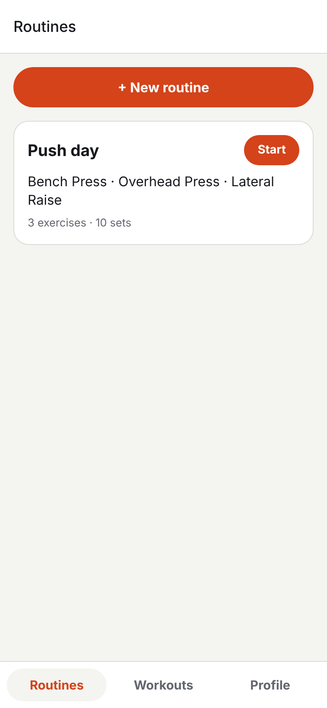
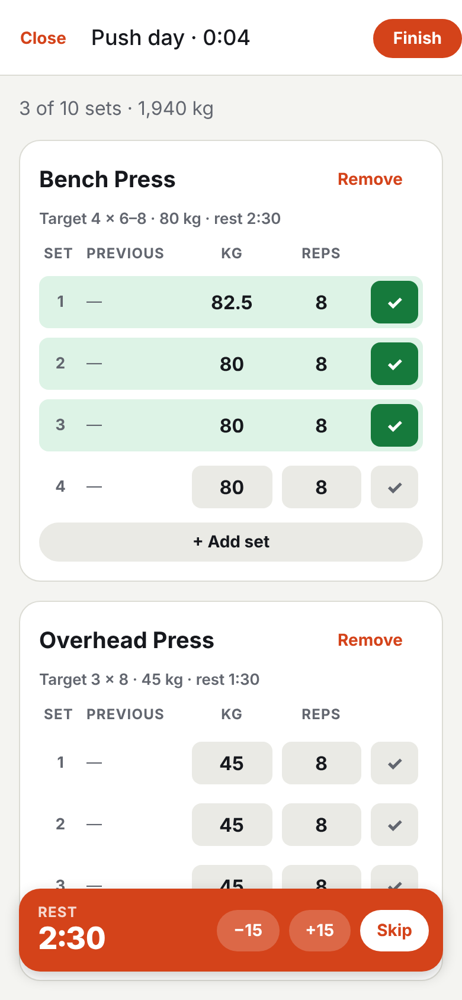
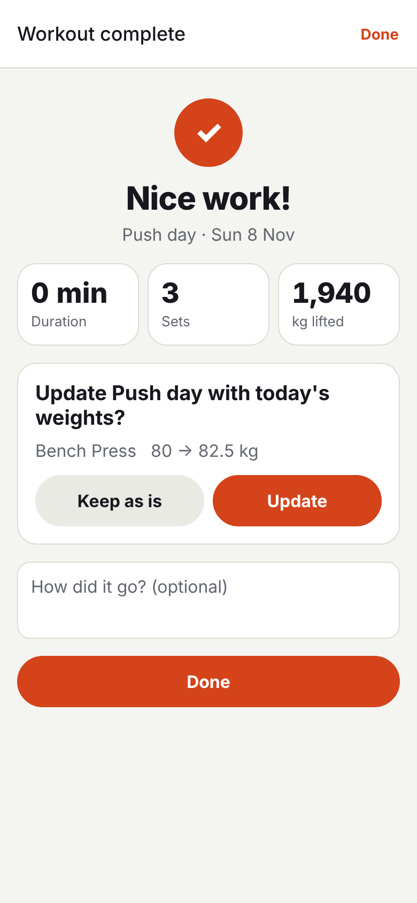
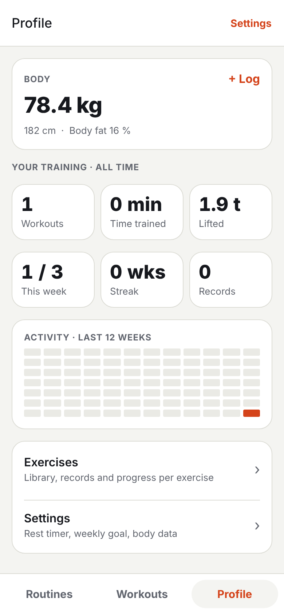

# Workout Log

[](https://github.com/lucabailo/workout-log/actions/workflows/ci.yml)

A mobile app to log strength workouts set by set and see progress over time. It works fully offline: all data lives in a SQLite database on the phone.

Built with **React Native (Expo)** and **TypeScript**, for iOS and Android (and the browser).

<p align="center">
  
  
  
  
</p>

Designed first in Figma (wireframes → colour system → hi-fi screens in light and dark), then built.

**Try it on Android:** download the APK from the [latest release](https://github.com/lucabailo/workout-log/releases/latest) and open it on your phone (allow installing from unknown sources when asked).

## Features

- **Your plan as routines:** write each day once (Push, Pull, Legs…) with sets, rep range, optional target weight and rest time per exercise
- **Start a routine in one tap:** every set is created up front, pre-filled with the target (or last time's weight); the rest timer uses each exercise's rest time
- **Summary after each workout:** duration, volume compared to the last time you did that routine, new records, and an offer to raise the routine's targets when you lifted more
- **Log a workout:** or start an empty one and add exercises as you go; fill in weight and reps and tick each set off
- **"Previous" column and personal records:** what you lifted last time, and a PR badge when a set beats your best estimated 1RM
- **Profile:** body weight trend, all-time totals, weekly goal and streak, a 12-week activity grid
- **Body measurements:** weight plus optional smart-scale values (body fat, muscle mass, body water, visceral fat), with a chart per metric
- **Exercise library:** 26 common exercises with their load type (barbell, dumbbell per hand, bodyweight + extra kg…), search, custom exercises, progress chart per exercise
- **Safe by design:** a workout in progress is stored immediately, so closing the app loses nothing; unticked sets are dropped on finish
- Light and dark mode, colours checked against WCAG AA

## Tech stack

| Area | Technology |
|---|---|
| App | React Native 0.88, Expo SDK 58, TypeScript |
| Navigation | Expo Router (file-based), native tabs on iOS/Android |
| Storage | expo-sqlite, schema migrations with `PRAGMA user_version` |
| Charts | Custom line chart drawn with react-native-svg |
| Tests | Jest (jest-expo); repository tests run real SQL on Node's built-in SQLite |
| Quality | ESLint (eslint-config-expo, React Compiler rules), `tsc --noEmit`, GitHub Actions |

## Project structure

```
src/
├── app/                    screens (Expo Router: every file is a route)
│   ├── (tabs)/routines/    your plan and routine detail
│   ├── (tabs)/workouts/    start a workout, history, workout detail
│   ├── (tabs)/profile/     body, stats, settings, exercise library
│   ├── onboarding.tsx      "About you" on first launch
│   ├── routine-edit.tsx    create / edit a routine
│   ├── active.tsx          the workout in progress
│   ├── summary.tsx         after "Finish"
│   └── pick-exercise.tsx   modal to choose an exercise
├── components/             UI building blocks (set row, rest timer, chart…)
├── db/                     schema, migrations and all SQL queries
├── domain/                 pure logic: 1RM, records, streak, target updates, formatting
└── hooks/                  data loading on screen focus, live clock, theme
```

## Design decisions

- **Logic separated from the UI.** Calculations such as the estimated 1RM (Epley formula), personal records and weekly counts are pure functions in `src/domain`, so they are tested without rendering anything.
- **A narrow database interface.** The repository depends only on the five methods of expo-sqlite it uses. In tests, a small adapter maps them to Node's built-in `node:sqlite`, so the real SQL runs against a real in-memory database.
- **Migrations from day one.** The schema version is stored in SQLite's `user_version`; adding a column later means adding one migration, and existing users keep their data.
- **The active workout is just a row without an end time.** There is never a separate in-memory state to lose, and the app can be closed mid-workout.
- **Personal records are computed, not stored.** They are derived from the history every time, so editing or deleting a workout can never leave a stale record behind.
- **A workout copies its routine, it doesn't link to it live.** Sets are created when the workout starts, so editing or deleting a routine later never changes past workouts; deleting a routine keeps its history.
- **Design tokens shared with Figma.** The colour names in `src/constants/theme.ts` are the same variables used in the Figma file, in a Light and a Dark mode.

## Running it

Requires Node 22.

```bash
npm install
npx expo start
```

Then scan the QR code with the **Expo Go** app on your phone (Android: from Expo Go; iPhone: with the Camera app). Press `w` in the terminal to open the web version instead.

## Build an APK (Android, without Expo services)

On Windows, once:

1. Install Android Studio and, in **SDK Manager → SDK Tools → Show Package Details**, CMake **3.31 or newer**.
2. Turn on long paths (PowerShell as administrator), then restart:
   ```powershell
   New-ItemProperty -Path "HKLM:\SYSTEM\CurrentControlSet\Control\FileSystem" -Name LongPathsEnabled -Value 1 -PropertyType DWORD -Force
   ```

Then, every time:

```bash
npm run build:apk   # → WorkoutLog-<version>.apk in the project folder
```

The script (`scripts/build-apk.ps1`) builds from `C:\wl`, because some generated C++ paths of React Native libraries exceed Windows' 260-character limit from deeper folders. Raise `android.versionCode` in `app.json` before each new build so it installs over the previous one.

## Tests and checks

```bash
npm test            # domain logic and database repository
npm run typecheck   # TypeScript
npm run lint        # ESLint
```

All three run on every push with GitHub Actions.

## Roadmap

- Account and cloud sync with a Spring Boot + PostgreSQL backend (login screens are already designed)
- Supersets, activity calendar, and a mini bar for the workout in progress (designed, not built yet)
- Import body measurements from Apple Health / Health Connect
- An installable build with EAS

---

Made by [Luca Bailo](https://www.linkedin.com/in/luca-bailo-3375a2230/) · MSc Software Design, IT University of Copenhagen
